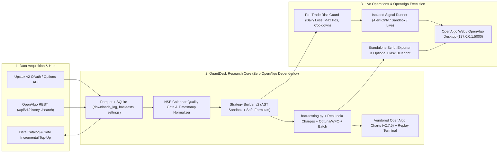

# QuantDesk v9.0 — Modular Indian Market Data, No-Code Research & OpenAlgo Execution Suite

**QuantDesk v9.0** is a modular, local-first quantitative research terminal, historical market-data manager, no-code strategy lab, and risk-guarded live execution bridge for Indian equities, indices, futures, options, commodities, and currencies.

Originally refactored from a single-file script into a strictly layered `quantdesk` Python package + thin [app_main.py](app_main.py) shell, **v9.0** introduces:
- **No-Code Strategy Builder v2** (Simple/Pro modes, custom indicator math blocks, AST-safe formula expressions, parenthesized rule groups, lookback timing, intraday entry time windows, 5 starter templates, live plain-English translator, sanity checks, and 1-click quick preview)
- **Offline `openalgo-charts` v2.7.5 Interactive Engine** (zero CDN requests, `Asia/Kolkata` IST timezone, candlesticks, overlays, stacked sub-panels with guide lines)
- **📊 Chart Backtester (Terminal)** (client-side Bar-by-Bar Replay + P&L HUD, synced Equity & Drawdown panes, Entry/Exit/SL/TP `PriceLine`s, clickable Trade Blotter, quick parameter overrides)
- **📡 Data Hub & OpenAlgo Unified Gateway** (Native Upstox OAuth + OpenAlgo 38+ broker REST integration, Data Coverage Catalog, provisional-bar-safe Incremental Top-Up, bulk ZIP export, isolated OpenAlgo Web/Desktop detector)
- **🚦 Live Monitor & Deploy Bridge** (OpenAlgo Funds/Positions/Orders/Tradebook telemetry, pre-trade Kill Switches, research-to-live parity signal runner with `Alert-Only → Sandbox → Live` progression, standalone OpenAlgo Python script exporter, and optional headless Flask Blueprint)

---

## Table of Contents

- [Architecture & Design Principles](#architecture--design-principles)
- [All 16 Dashboard Pages](#all-16-dashboard-pages)
- [Quick Start (Windows & Cross-Platform)](#quick-start-windows--cross-platform)
- [Authentication Setup (Upstox & OpenAlgo)](#authentication-setup-upstox--openalgo)
- [Core Workflows](#core-workflows)
- [OpenAlgo Ecosystem Integration](#openalgo-ecosystem-integration)
- [Headless API, CLI & Packaging (`v9.0.0`)](#headless-api-cli--packaging-v900)
- [Repository Layout](#repository-layout)
- [Testing & Verification](#testing--verification)
- [Security & Trading Disclaimer](#security--trading-disclaimer)

---

## Architecture & Design Principles



### Key Architectural Guarantees
1. **Strict UI/Backend Separation:** No module under `quantdesk/strategy/`, `quantdesk/backtest/`, `quantdesk/risk/`, `quantdesk/costs/`, `quantdesk/data/`, `quantdesk/ml/`, `quantdesk/live/`, or `quantdesk/viz/` imports `streamlit`. All analytics run cleanly in CLI, multiprocessing workers, headless endpoints, and automated tests.
2. **Loose Coupling to OpenAlgo:** QuantDesk has **zero runtime `import openalgo` dependencies**. Everything communicates over OpenAlgo's documented HTTP JSON v1 API (`127.0.0.1:5000`), and `openalgo-charts` v2.7.5 (Apache-2.0) is vendored locally inside [quantdesk/viz/assets/openalgo-charts/](quantdesk/viz/assets/openalgo-charts/).
3. **Two-Layer Code Safety:** Every strategy compiled through QuantDesk passes both `validate_preset()` (input schema + expression validation) and `assert_safe_ast()` (compiled source AST sandbox blocking dangerous imports, builtins, and dunder escapes). Custom formulas use a strict expression-only AST evaluator (`assert_safe_formula()`).
4. **Honest Backtest Accounting:** Out-of-sample Optuna/Grid validation, Walk-Forward Optimization (WFO), India segment-accurate statutory charges (STT, stamp duty, exchange fees, SEBI turnover, brokerage, GST), NSE trading-calendar missing-day penalties, and content/config/strategy SHA reproducibility hashes.

---

## All 16 Dashboard Pages

Local research, backtesting, charting, optimization, results, and dry-run features work **without any broker login**. Only live brokerage downloads and Upstox expired options require active authentication.

| Category | Page | Purpose |
|---|---|---|
| **Broker Downloads** | `🗃️ Master Data Downloader` | Fetch exchange instrument lists & run universe presets |
| | `📊 Single Instrument Data` | Async historical OHLCV download + minute resampling + CSV/Parquet export |
| | `📦 Bulk Data Downloader` | Multi-symbol basket downloads with chunk completeness & retry telemetry |
| | `📉 Options Chain (Upstox)` | Upstox expired/active expiry contracts & options chain downloader |
| **Data & OpenAlgo** | `📡 Data Hub & OpenAlgo` | Coverage catalog, provisional-safe incremental top-up, ZIP export, OpenAlgo status & live search |
| | `📁 Local Data Converter` | Import/normalize local CSV & Parquet OHLCV files (`+05:30` / naive IST) |
| | `🗄️ Download Logs` | Inspect downloaded files recorded in `downloads_log` |
| | `🛠️ Data Management` | Rebuild DB catalog from disk (`recovery.py`) & backup management |
| | `⚙️ Settings` | Default brokerage, slippage, margin, capital, Parquet/CSV folders |
| **Research & Backtest** | `🛠️ Strategy Builder` | **Builder v2:** Simple/Pro modes, 31 indicators + Custom Formula, grouped rules, lookbacks, templates & plain-English summary |
| | `📈 Strategy & Indicator Plotter` | Signal inspection sheet & interactive multi-panel OpenAlgo / Plotly chart |
| | `🚀 Backtester` | Single run, WFO, Optuna/Grid OOS optimizer, Folder Batch Mode, Monte Carlo, QuantStats & India tax export |
| | `📊 Chart Backtester (Terminal)` | Chart-first terminal with linked Equity/Drawdown, client-side Bar-by-Bar Replay HUD & clickable Trade Blotter |
| | `📊 Backtest Results` | Leaderboard comparing single + batch runs, Sharpe/DSR & saved equity curves |
| | `🤖 ML Pattern Finder` | XGBoost feature importance + Wilson/FDR-gated out-of-sample decision-tree rules |
| **Live & Automation** | `🚦 Live Monitor & Deploy` | Live OpenAlgo funds/positions/orders monitor, 1-cycle dry/live checks, isolated background runner & `.py` bot export |

---

## Quick Start (Windows & Cross-Platform)

### Option A — One-Click Windows Launch
```bat
install.bat            :: sets up isolated QuantDesk .venv (Python 3.12 via uv)
run.bat                :: launches QuantDesk dashboard at http://localhost:8501
```

Optional separate **OpenAlgo Sidecar** workflow (keeps OpenAlgo in its own isolated `services\openalgo\.venv` so dependencies never conflict with QuantDesk — or simply run **OpenAlgo Desktop** at `http://127.0.0.1:5000`):
```bat
install_openalgo.bat   :: clones & installs OpenAlgo into services\openalgo\.venv
run_with_openalgo.bat  :: starts OpenAlgo sidecar (if port 5000 is free) + QuantDesk
```

### Option B — Manual Setup (Windows / macOS / Linux)
```bash
python -m venv .venv
# Windows: .venv\Scripts\activate
# macOS/Linux: source .venv/bin/activate
pip install -r requirements.txt
streamlit run app_main.py
```

### Option C — Editable Package + Headless OpenAlgo Extra
```bash
pip install -e ".[openalgo]"
```
Exposes the `quantdesk-live` CLI entrypoint (`quantdesk.live.signal_runner:main`) and optional Flask blueprint support.

---

## Authentication Setup (Upstox & OpenAlgo)

QuantDesk's sidebar supports **two clean authentication paths**:

1. **Upstox (Direct OAuth + Options Chain):**
   - Enter your `Upstox API Key`, `Upstox API Secret`, and `Redirect URI` (default `http://localhost:8501`) in the sidebar and click **`Save to .env`** (writes gitignored `.env` at the project root so keys persist across OAuth redirects and restarts).
   - Click **`👉 Open Upstox Login (New Tab)`**, sign in on Upstox, paste the `?code=...` value (or full redirect URL) into `Auth Code (from URL)`, and click **`Login (Upstox)`**.

2. **OpenAlgo (Unified Gateway for 38+ Brokers):**
   - Run **OpenAlgo Web** or **OpenAlgo Desktop** (Tauri/Rust) locally at `http://127.0.0.1:5000` and authenticate your broker once in OpenAlgo's UI.
   - Copy your OpenAlgo API key into QuantDesk's sidebar under **`OpenAlgo`** (`http://127.0.0.1:5000`) and click **`Connect OpenAlgo`**.
   - QuantDesk automatically verifies `/api/v1/ping` and `/api/v1/analyzer` (Sandbox vs Live mode).

---

## Core Workflows

### 1. Build Strategies Without Coding (`🛠️ Strategy Builder`)
- **Simple (Guided) Mode** for beginners: 5 1-click **Starter Templates** (*Golden Cross*, *RSI Oversold Bounce*, *Bollinger Breakout*, *Supertrend + Volume Surge*, *Intraday MIS Pullback*), beginner indicator descriptions, readable auto-names (`EMA_14`, `RSI_14`), live **Plain-English Strategy Summary**, beginner trap **Sanity Warnings**, and **Quick Test Strategy (Preview)**.
- **Pro (All Controls) Mode** for complex systems:
  - **27 classic & normalized indicators** (SMA, EMA, WMA, ALMA, RSI, MACD, Bollinger, ATR, Supertrend, Parabolic SAR, ADX, Stochastic, VWAP, Keltner, Donchian, Hurst Exponent, HMM Regime, Z-Score, Percentile Rank, ATR-Normalized Slope/Distance).
  - **4 custom building blocks:** `Series Math` (`add`, `sub`, `mul`, `div`, `pct_diff` across two series or fixed constants), `Rolling Stat` (`max`, `min`, `mean`, `sum`, `std`), `Bar Shift`, and **`Custom Formula`** (`(Close - ema(Close, 20)) / atr(14)` with AST whitelist checks blocking assignments, loops, and dangerous builtins).
  - **Grouped Logic & Lookbacks:** parenthesized condition groups `(A AND B) OR (C AND D)`, rule `NOT` negation, timing conditions (`Now`, `N bars ago`, `Within last N bars`, `For N consecutive bars`), No-Trade Regime filters, Range Zones, and **Intraday Entry Time Windows (`HH:MM`–`HH:MM`) + MIS Square-Off**.
  - **Institutional Risk Sizing:** Static %, ATR Volatility Stop, Trailing %, Indicator Exit, Breakeven stop ratchet, Scale-out partial exits, Time stop (`max_bars_in_trade`), Risk-% equity sizing, Half/Full Adaptive Kelly sizing, and Max-DD circuit breaker.

### 2. Visual Chart Terminal & Replay (`📊 Chart Backtester (Terminal)`)
- Select any downloaded dataset + compiled strategy or Starter Template.
- Tweak indicator periods, rule thresholds, SL/TP/Trailing %, direction, or India cost segment without overwriting your Builder preset.
- Explore trades on an offline **OpenAlgo Interactive Terminal** featuring:
  - Client-side **Bar-by-Bar Replay** (`⏮ Start`, `▶ Play / ⏸ Pause`, `⏭ Step`, `1x–50x`, progress scrubber, live OHLC/Equity/DD/Win-Rate HUD)
  - Synchronized bottom **Equity & Drawdown %** chart via `createLinkGroup`
  - **Clickable Trade Blotter** jumping the chart directly to any trade with Entry, Exit, SL, and TP `PriceLine` overlays

### 3. Incremental Data Management (`📡 Data Hub & OpenAlgo`)
- View all stored Parquet/CSV coverage (`symbol`, `interval`, actual bar dates, file size) and optionally score NSE trading-calendar gaps.
- Run **1-click Incremental Top-Up to Today**: rewinds a configurable lookback guard window (default 2 days) and merges with `keep="last"` so incomplete intraday bars from earlier pre-close fetches are cleanly overwritten.
- Export selected datasets as a single **ZIP archive**.

---

## OpenAlgo Ecosystem Integration

QuantDesk treats OpenAlgo as a clean HTTP sidecar (`127.0.0.1:5000`):
- **Historical Data Adapter (`quantdesk/brokers/openalgo.py`):** Pulls history across all OpenAlgo brokers via strict Marshmallow payloads (`/api/v1/history`, `/api/v1/search`) and normalizes epoch timestamps to tz-naive IST.
- **Sidecar Monitor (`quantdesk/integrations/openalgo_manager.py`):** Detects running OpenAlgo Web or OpenAlgo Desktop instances, measures latency, and provides commands for an optional isolated sidecar environment (`services/openalgo/`).
- **Risk-Guarded Live Runner (`quantdesk/live/`):**
  - Never executes live trading loops inside Streamlit reruns.
  - Defaults to **`alert_only`**, supports **`sandbox`** (OpenAlgo Analyzer virtual capital), and gates **`live`** behind an explicit confirmation flag plus daily loss, max trades/day, max open positions, and bar deduplication checks.
  - CLI usage:
    ```bash
    python -m quantdesk.live.signal_runner --preset strategies/my_strat.json --symbol RELIANCE --exchange NSE --interval 15m --mode alert_only --once
    ```
- **Standalone Bot Exporter (`quantdesk/strategy/openalgo_export.py`):** Exports a runnable, secret-free Python script using `OPENALGO_API_KEY` from environment variables.

---

## Headless API, CLI & Packaging (`v9.0.0`)

For headless integration alongside OpenAlgo Flask deployments (`quantdesk/integrations/openalgo_blueprint.py`):

```python
from quantdesk.integrations.openalgo_blueprint import run_headless_backtest, create_openalgo_blueprint

# Run a validated backtest headlessly without Streamlit:
result = run_headless_backtest(preset_dict, ohlcv_records, initial_capital=100000.0, segment="Equity Intraday")

# Optional Flask blueprint (requires `pip install -e ".[openalgo]"`):
# app.register_blueprint(create_openalgo_blueprint("/quantdesk"))
```

---

## Repository Layout

```
app_main.py                          Thin Streamlit shell (auth sidebar, 16-page nav, dispatcher)
pyproject.toml                       PEP 621 package metadata (v9.0.0) & quantdesk-live CLI
install.bat / run.bat                Windows uv virtual environment installer & launcher
requirements.txt / requirements-dev.txt
quantdesk/
  config.py                          Paths, defaults, indicator placement & panel guide maps
  core/                              db · settings_repo · logging · cache · reproducibility
  data/                              loader · catalog · quality · corporate_actions · master_list · recovery · resample · saver
  brokers/                           base · downloader · openalgo · upstox · (legacy zerodha · dhan)
  strategy/                          models · indicators · codegen · compiler · templates · validation · presets · openalgo_export
  backtest/                          engine · worker · batch · optimizer · wfo · metrics
  risk/                              sizing · stops
  costs/                             india (STT, stamp, exchange, SEBI, brokerage, GST fee models)
  ml/                                patterns (XGBoost + FDR/Wilson decision-tree rule mining)
  viz/                               openalgo_chart · openalgo_terminal · charts · assets/openalgo-charts/
  live/                              openalgo_client · risk_guard · signal_runner
  integrations/                      openalgo_manager · openalgo_blueprint
  ui/                                components · builder_helpers · pages/*.py (16 modular pages)
tests/                               Unit, security AST, parity, OpenAlgo charts/bridge & Streamlit AppTest suites
docs/archive/                        Historical v5-v8 roadmaps & refactor index
ARCHITECTURE.md / STATUS.md / CHANGELOG.md
```

---

## Testing & Verification

Set a writable `NUMBA_CACHE_DIR` if running in a restricted environment:

```powershell
# Run full test suite (use --ignore=tests/test_downloader.py if asyncio socketpair is restricted)
python -m pytest tests/ --ignore=tests/test_downloader.py -p no:cacheprovider -q

# End-to-end headless Streamlit verification across all 16 UI pages + Backtester execution
python tests/verify_app.py

# Deep UI feature checks (plotter, strategy builder, settings, grid optimizer)
python tests/verify_features.py
```

---

## License & Commercial Use (`AGPL-3.0` Dual-Licensing)

- **Open Source License (`AGPL-3.0`):** QuantDesk is free and open-source software licensed under the **GNU Affero General Public License v3.0** (see [LICENSE](LICENSE)).
- **Network / SaaS Copyleft:** If you modify QuantDesk and either distribute it **or run it as a web/network/SaaS service for other users**, you **must** make the complete source code of your modified version publicly available under `AGPL-3.0`.
- **Commercial Closed-Source Restriction:** Any commercial entity wishing to deploy modified versions internally as a closed product/service without open-sourcing changes back to the community under `AGPL-3.0` must obtain a separate **commercial license** from the maintainer (`gauravrakhecha@gmail.com`).
- **Contributing:** See [CONTRIBUTING.md](CONTRIBUTING.md) before opening Pull Requests.
- **Third-Party Notices:** Vendored [`openalgo-charts`](quantdesk/viz/assets/openalgo-charts/) v2.7.5 is licensed under Apache-2.0 with its original `LICENSE` and `NOTICE` preserved cleanly.

---

## Security & Trading Disclaimer

- **Secrets:** Never commit `.env`, SQLite `.db` files, or API keys. `.gitignore` excludes `.env`, `*.db`, `data/`, `plots/`, `.venv/`, and local caches.
- **No Financial Advice / Live Trading Risk:** QuantDesk is provided for educational, backtesting, and algorithmic workflow research. Always test strategies thoroughly in **`alert_only`** and **OpenAlgo `sandbox` (Analyzer)** modes before enabling **`live`** execution, and configure conservative daily max-loss kill switches.
